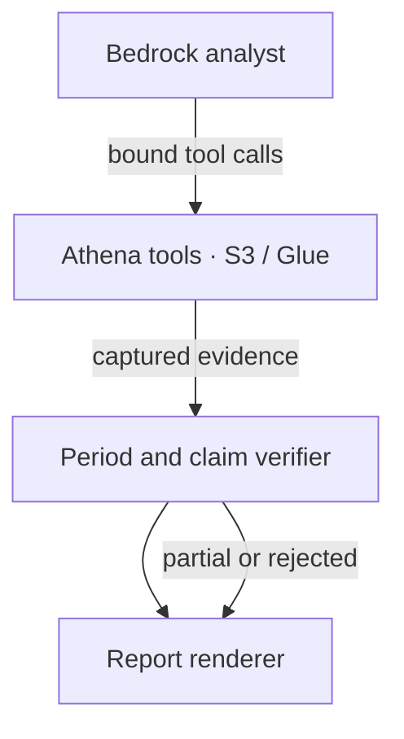

# Weekly Business Review Agent — Team S04

Preparation draft for the organizer's one-page template. Not a final PDF or submission. Replace unresolved fields with confirmed facts before release.

**Person and task.** Target role: an operations analyst who manually assembles weekly revenue, order, customer review, category and customer-state findings. The project compares Olist e-commerce weeks, investigates changes and links report claims to captured query evidence. Actual user identity and current manual minutes/cost have not been confirmed; do not invent them or claim measured savings.

**Agent behavior.** The analyst chooses a plan and calls allowlisted data tools. Wrappers force the run week, preserve query metadata and record overridden model requests. Validation checks completion, evidence periods, numeric claims and unsupported causal/containment wording. The report renderer displays confirmed findings, separates unconfirmed review items, and withholds removed claims. Failures produce an explicit partial or rejected result.

**Architecture.** Public Olist source and planted fixtures → S3/Glue tables → allowlisted Athena query tools called by the Bedrock/Nova analyst → captured evidence, postchecks and shared verifier → offline HTML report. DuckDB is the local development/reference backend. The HTML renderer itself does not call AWS.

**AWS services.** Bedrock provides model inference; Athena executes data queries; S3 stores data and query results; Glue supplies the catalog. This describes the implemented architecture and saved evidence, not a new corrected live test. The recorded earlier parity evidence reports 13/13 matches; that parity was not rerun during this offline integration.

**Failure demonstration and evidence.** An earlier S1 capture passed its original grader but remains PARTIAL under the current conservative bridge. A later S1 capture used the wrong week in 12 tool results and is now REJECTED at replay. A derived offline review-tool failure illustrates missing-evidence handling; it is synthetic, not an official new S5 evaluation. The private candidate passes 197 offline tests plus 43 subtests; 11 database-dependent tests are still unrun here. The founder separately reproduced the earlier 187-test suite on his Mac.

**Responsible AI.** Numeric and period evidence precedes presentation. Incomplete data and unavailable tools remain visible. Tentative causal and group-containment language is conservatively flagged. No causal discovery or universal prose-verification claim is made. Source data is public Olist with clearly labeled planted scenarios; no raw source dataset or credentials are committed in this candidate.

**What comes next.** Finish full golden-data and bridge acceptance, independent review and an authorized bounded corrected-model test. Confirm a real target workflow and measure time saved/acceptance before making adoption claims. Improve claim verification and task handoff so the analyst can accept the report without recreating it.

**Team/links pending confirmation.** Franklyn Rosario, MBA-ITM; Lakshmi Bharathy Kumar; Maxime Gillot. Confirm final roster/email addresses, contribution credit and submission lead. Public repo URL, video URL and final template PDF are outstanding release/submission items.
