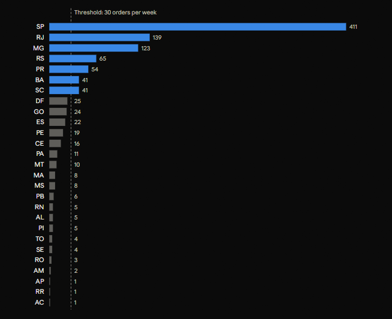
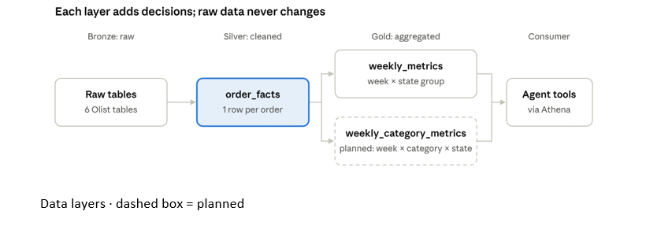

# WBR Agent: Stage 1 Data Foundation

**Last updated:** October 6, 2026 · **Author:** Lakshmi Bharathy Kumar (L)

## Contents

1. [Purpose and scope](#purpose-and-scope)
2. [Dataset and source](#dataset-and-source)
3. [Environment and workflow](#environment-and-workflow)
4. [Table-by-table review](#table-by-table-review)
5. [Data quality findings](#data-quality-findings)
6. [Validation: late delivery and review scores](#validation-late-delivery-and-review-scores)
7. [Time coverage and analysis window](#time-coverage-and-analysis-window)
8. [Grouping small states and categories](#grouping-small-states-and-categories)
9. [Metric definitions and business rules](#metric-definitions-and-business-rules)
10. [Data model](#data-model)
11. [Verification](#verification)
12. [Planned statistical approach for flagging changes](#planned-statistical-approach-for-flagging-changes)
13. [Open decisions and next steps](#open-decisions-and-next-steps)

---

## Purpose and scope

Stage 1 builds the data foundation the WBR agent's query tools will read: a cleaned order-level table and weekly summary tables, with every definition and decision recorded here.

This document records what was done, why, and how it was checked, so teammates can review the logic and anyone debugging a number can trace it back to a decision.

**Covered in stage 1:**

- Review of the six Olist tables used
- Data quality findings and how each was handled
- A validation analysis linking late delivery to review scores
- Grouping of small states and categories, with the statistical rationale
- Metric definitions and business rules
- The order-level fact table (`order_facts`) and both summary tables (`weekly_metrics`, `weekly_category_metrics`)

**Still pending at the time of writing:**

- Exporting to Parquet, uploading to S3, and creating Athena tables
- Confirming DuckDB and Athena return the same numbers
- Recording the late-order count from `order_facts`
- The dataset license wording for the README

## Dataset and source

We use the public [Olist Brazilian E-Commerce dataset](https://www.kaggle.com/datasets/olistbr/brazilian-ecommerce): 99,441 orders placed between September 2016 and October 2018 on a Brazilian online marketplace, published as 9 linked CSV files.

**Why this dataset:** it is the only common public e-commerce dataset we know of that links orders, item prices, delivery dates, and customer reviews. That chain (purchase → delivery → review) is what lets the agent investigate *why* a metric changed, not just *that* it changed. Alternatives considered lacked delivery data (UCI Online Retail II), order and delivery operations (Amazon review datasets), prices and real dates (Instacart), or delivery and reviews (Google GA4 sample).

**Tables used (6):** `orders`, `order_items`, `order_reviews`, `customers`, `products`, `product_category_name_translation`.

**Tables not used (3):**

- **`order_payments`:** payment method and amount; not needed for the three questions, since revenue uses item prices.
- **`sellers`:** seller location; seller-level analysis is out of scope.
- **`geolocation`:** zip-code coordinates; the largest file and not needed, since we break down by state.

**Known limitations:**

- Brazilian data: Portuguese text, Brazilian states, prices in Brazilian reais (BRL), not US dollars.
- Old data (2016 to 2018): dates will be shifted for the demo.
- No website traffic, cart, marketing, or inventory data, so funnel and marketing metrics are out of scope.

**License:** confirm on the Kaggle page before writing the README. Raw data is never committed to Git; a download script will be provided instead.

## Environment and workflow

**Tools:**

| Tool | Role | Why |
| --- | --- | --- |
| VS Code | Editor for notebooks, SQL, and Python | Code goes straight into the repo |
| Python virtual environment (`.venv`) | Isolated packages for this project | Same package versions for everyone; nothing leaks from other projects |
| DuckDB | Local SQL database, run from Python | Free, no server, reads CSVs directly; SQL ports to Athena with small changes |
| Jupyter notebooks | Exploration | Run step by step and see results inline |
| `.sql` files | Final table logic | Reviewable in pull requests; runnable from scripts |
| GitHub Desktop + VS Code terminal | Version control | Desktop for the team repo, terminal for the personal mirror |

**Folder layout (relevant parts):**

- `data/raw/`: original Olist CSVs, unchanged
- `data/olist.duckdb`: local database holding raw and derived tables
- `notebooks/`: exploration notebooks
- `sql/`: `order_facts.sql`, `weekly_metrics.sql`, `weekly_category_metrics.sql`
- `docs/`: this document; `docs/Images/` holds its figures

**Git rules agreed by the team:**

- One branch per task (this work: `work/Lakshmi-data-tools`, with a capital L; branch names are case-sensitive), pull requests into `main`, another teammate reviews, squash merge.
- Never commit raw data, `.duckdb` files, `.env` files, or credentials.
- `.gitignore` covers `data/raw/`, `*.duckdb`, `*.duckdb.wal`, and `.venv/`.

**Habit:** the DuckDB connection cell is the first cell of every notebook; after a kernel restart, run cells from the top.

## Table-by-table review

The **grain** of a table is what one row represents. Knowing the grain is what prevents double counting when tables are joined.

| Table | Rows | Grain (one row =) | Key columns used | Notes |
| --- | --- | --- | --- | --- |
| `orders` | 99,441 | One order | order_id, customer_id, order_status, purchase, approval, delivery, and estimated delivery timestamps | Central table; dates are proper timestamps |
| `order_items` | 112,650 | One item in an order | order_id, order_item_id, product_id, price, freight_value | About 1.13 items per order; no quantity column, so repeated products appear as separate rows |
| `reviews` | 99,224 | One review | order_id, review_score | Reviews are at order level, not item level; some orders have none, a few have several |
| `customers` | 99,441 | One customer record per order | customer_id, customer_state | customer_id is new for every order; the real person is customer_unique_id |
| `products` | 32,951 | One product | product_id, product_category_name | No product names; category is the most descriptive field |
| `category_translation` | 71 | One category | Portuguese and English names | Two categories in products have no translation |

**Column decisions worth knowing:**

- **IDs stay as text (VARCHAR).** They are hashed codes, not numbers, and are only matched, never calculated with. Converting would also drop leading zeros.
- **Timestamps stay in standard format** (`2017-10-02 10:56:33`). Display formats like m/d/y are applied only in reports; as text they break sorting and date math.
- **Prices are DOUBLE** (decimal numbers). Tiny floating-point rounding is expected; values are rounded to 2 decimals for display.
- **Original column spellings are kept,** including Olist's misspelled `product_name_lenght`, so code matches the source.
- **customer_id vs customer_unique_id:** joins use customer_id (one per order). Counting distinct people would need customer_unique_id; none of the three questions requires it.

## Data quality findings

Guiding rule: **only clean columns we use, and never change the raw tables.** Fixes are applied in SQL when building derived tables, so the raw data stays traceable.

| Finding | Measured | Handling | Why |
| --- | --- | --- | --- |
| Products with no category | 610 products (1.9%); 1,603 items (1.4%); about 179,500 BRL (1.3% of revenue) | Labeled `unknown` with `COALESCE`; grouped into Other | Dropping them would remove real revenue, so totals would no longer add up |
| Categories with no English translation | 2: `pc_gamer`, `portateis_cozinha_e_preparadores_de_alimentos` | Translated manually in SQL (`gaming_pc`, `portable_kitchen_food_preparers`) | Keeps reports fully in English without editing the source CSV |
| Orders with more than one review | Present (count to record) | Averaged into one score per order | Prevents an order counting twice in the average |
| Orders without a review | 99,224 reviews for 99,441 orders | Excluded from review metrics only | No score to average; the order still counts for revenue |
| Empty review titles and comments | Many | Left as NULL; columns not used | Writing a comment is optional, so NULL is real information |
| Delivered orders missing a delivery date or review | About 650, from the validation analysis | Excluded from delivery metrics | No date means late status and delivery time can't be calculated |
| Zip code prefix loaded as a number | Leading zeros lost | Not used | Identifier-like columns should be text; noted for future use |
| Sparse early weeks and incomplete final weeks | See [Time coverage](#time-coverage-and-analysis-window) | Excluded by the analysis window (2017-01-30 to 2018-08-13) | Thin weeks create false "changes" |

**One subtle effect:** averaging multiple reviews can hide a 1-star review (a 1 and a 3 average to 2.0, which is not counted as 1-star). This affects only orders with several reviews.

## Validation: late delivery and review scores

**Question:** are review scores really related to delivery? Reviews are at order level and could reflect the product, packaging, seller, or delivery. Before using delivery as evidence for review changes, we tested the link with numbers rather than assuming it.

**Method:**

1. One review score per order (average if several).
2. Delivered orders that have both an actual and an estimated delivery date.
3. **Late** = actual delivery date after the estimated date, comparing dates, not timestamps. The estimate has no time of day (midnight), so a timestamp comparison would wrongly mark same-day deliveries as late.
4. Compare the two groups on average score, share of 1-star, and share of 4–5 star reviews.

**Result:**

| Delivery | Orders | Avg review | 1-star | 4–5 star |
| --- | --- | --- | --- | --- |
| Late | 6,381 | 2.27 | 53.7% | 26.7% |
| On time | 89,443 | 4.29 | 6.6% | 82.6% |

- Late orders score about **2 stars lower** on average.
- More than half of late orders get **1 star**, about **8 times** the on-time rate.
- Late orders are about **6.7%** of delivered orders, consistent with a published analysis of the same dataset (6.6%), which supports the logic.

**Conclusion:** late delivery is strongly **associated** with lower review scores, which justifies the agent using delivery as evidence when investigating review changes.

**Limitations:**

- **Association, not causation.** Late orders may differ in other ways (size, region, product type). This is why the agent labels such findings "observed pattern."
- About 650 delivered orders were excluded for missing a delivery date or review.

**Possible follow-up:** group late orders by how late (1–3, 4–7, 8+ days). If scores keep falling as delays grow (a dose-response pattern), the evidence is stronger.

## Time coverage and analysis window

**Date range:** first order 2016-09-04 21:15:19, last order 2018-10-17 17:30:18.

*Figure 1. Orders per week across the full dataset, used to choose the analysis window.*

**What the chart shows (approximate):**

- **2016:** nearly zero, apart from one small blip in early October, then almost nothing through December. Unusable.
- **January–February 2017:** ramp-up from near zero to about 500 orders a week.
- **2017 to mid-2018:** steady growth, about 500–1,000 orders a week in 2017 and 1,500–2,000 in 2018.
- **Week of Monday 20 November 2017:** spike to about 3,000 orders. This is the Black Friday week (Friday 24 November 2017); real demand, kept in the data. The following week will look like a large drop by comparison.
- **Late December 2017 and mid-June 2018:** dips. December fits the holidays; the June cause is unknown, a candidate for an "unexplained" finding.
- **Late August 2018 onward:** sudden fall to near zero. This is the end of data collection, not a business collapse.

**Window decision: weeks starting 2017-01-30 through 2018-08-13, inclusive (81 weeks).**

The boundary weeks were read from weekly order counts:

| Week starting | Orders | Decision |
| --- | --- | --- |
| 2017-01-02 to 2017-01-16 | 46, 80, 197 | Excluded: ramp-up |
| 2017-01-23 | 354 | Excluded: just below the February level and still climbing |
| **2017-01-30** | **467** | **Start:** first week inside the steady February range (379–548) |
| 2018-07-23 to 2018-08-06 | 1,646 to 2,058 | Normal |
| **2018-08-13** | **1,875** | **End:** last week in line with the weeks before it |
| 2018-08-20 | 1,071 | Excluded: about half the normal level, data collection winding down |
| 2018-08-27 onward | 130, then single digits | Excluded: clearly incomplete |

**Why exclude 2017-01-23:** comparing it with the next week would show a 32% "increase" that is only the store still ramping up.

**Why exclude 2018-08-20:** a half-empty week would look like a 43% revenue crash.

In SQL: `WHERE week_start BETWEEN DATE '2017-01-30' AND DATE '2018-08-13'`.

The window is applied when the tools query the data. `weekly_metrics` keeps all weeks, so the incomplete final weeks remain available as a real "incomplete data" failure case for the demo.

**Why it matters:** comparing a normal week with a thin or incomplete week creates false "changes," which is exactly what the agent must avoid reporting.

## Grouping small states and categories

**Method name:** rare category grouping (also called long-tail grouping, or top-N + Other; in machine learning, rare label encoding). Groups with enough data keep their own row; small groups merge into one group called **Other**.

**The problem it solves: small-sample variance.** The uncertainty of an average or percentage shrinks roughly with 1 ÷ √n (the standard error), where n is the number of orders. A group with 25 orders is about 4 times noisier than one with 400 (√400 ÷ √25 = 4). If a tiny state goes from 5 orders to 3, that looks like a 40% drop but is just 2 orders. Without grouping, the agent would report random swings as findings: false positives.

**The threshold: a median of at least 30 orders per week.**

- **Why 30: the Central Limit Theorem (CLT).** The CLT says the average of a sample follows an approximately normal (bell-shaped) distribution once the sample is large enough, even when individual values do not. Around 30 observations is the common rule of thumb where normal-based tools (z-scores, confidence intervals) become reasonable. At n = 30 the t-distribution's 95% critical value is about 2.04, close to the normal 1.96, so the simpler normal approximation is acceptable.
- **Why the median week,** not the mean: a few spikes (Black Friday) would inflate the mean and overstate a state's typical size.
- **Caveat: 30 is a convention, not a law.** Skewed data (like revenue) needs more, and 30 makes normal tools valid without guaranteeing precision.

**Confirmed by two more checks:**

- **Natural break (elbow):** a clear gap between SC and BA (median 41) and DF (median 25).
- **Coverage:** the kept states hold about 84% of orders in the window (81,764 of 97,214), so the breakdown still explains most of the business.

*Figure 2. Median weekly orders by customer state, analysis window 2017-01-30 to 2018-08-13. Source: Olist orders joined to customers.*

**Result for states:** SP, RJ, MG, RS, PR, BA, SC keep their own groups; the other 20 states form **Other**, which is large and stable as a combined group (about 16% of orders). That gives 8 state groups. The grouping was first run on a placeholder window and re-run on the final window; the kept states did not change.

**Caveat for rare-event rates such as late delivery %:** what matters is the number of *events*, not just orders. A common guideline is at least 10 events. At a late rate of about 7%, 30 orders contain only about 2 late orders, so one extra late order moves the rate from 6.7% to 10%. A state can therefore be large enough for revenue but too small to trust its weekly late %. This is handled at the flagging stage with a small-sample warning, not by the grouping.

**Categories:** the same rule applies (median of at least 30 orders per week, counted as distinct orders per category, final window), with **unknown always sent to Other**, since an "unknown" category is not actionable for an analyst even if it were large.

**Result for categories: 14 kept, plus Other = 15 category groups.**

| Category | Median weekly orders | Category | Median weekly orders |
| --- | --- | --- | --- |
| bed_bath_table | 114 | cool_stuff | 45 |
| sports_leisure | 92 | toys | 41 |
| health_beauty | 82 | garden_tools | 40 |
| furniture_decor | 67 | auto | 36 |
| computers_accessories | 66 | perfumery | 35 |
| housewares | 65 | baby | 34 |
| watches_gifts | 64 | | |
| telephony | 48 | | |

- **Natural break:** baby (34) to electronics and stationery (24), a gap of 10.
- **Coverage:** about 76% of orders fall in the 14 kept categories, 24% in Other. Lower than for states because orders spread across about 70 categories, a longer tail.
- **unknown:** median 14 per week, so it would fall into Other by the threshold anyway.
- **Caveat:** Other is a mixed group, so findings about it are less actionable; the agent can still report them for an analyst to dig into.
- The original plan's "top 10" was a guess; the data gave 14.

**Unknown category handling:** products with no category are kept (labeled `unknown`) so revenue totals stay complete, then grouped into Other.

## Metric definitions and business rules

**Order-level rules:**

| Rule | Definition | Why |
| --- | --- | --- |
| Week | Monday of the purchase week: `date_trunc('week', purchase_timestamp)` | One consistent time basis for every metric, including reviews |
| Revenue order | Status not `canceled` or `unavailable`, and payment approved (`order_approved_at` not empty) | Booked revenue: counted when paid, not when delivered, so recent weeks are not undercounted by orders still in transit |
| Canceled order | Status `canceled` or `unavailable` | Lets the agent check whether a revenue drop came from cancellations |
| Product revenue | Sum of item prices for revenue orders; excludes shipping | Measures product spending; shipping changes would otherwise look like sales changes. Freight is kept in its own column |
| Delivered | Status `delivered` with an actual delivery date | Only these have a delivery date to measure |
| Late | Delivered, and actual delivery date after estimated date (dates, not timestamps) | The estimate has no time of day; see [Validation](#validation-late-delivery-and-review-scores) |
| Delivery days | Days from purchase date to delivery date | Shows whether delays are spreading or worsening |
| Review score | One score per order, averaging multiple reviews | Prevents double counting |

**On "product revenue" as a term:** excluding shipping is common in e-commerce reporting (merchandise or product revenue) but not universal: some GMV definitions and accounting treatments include shipping fees. The column is named `product_revenue` so the definition is clear from the name.

**KPIs per question:**

| Question | Headline KPI | Supporting KPIs |
| --- | --- | --- |
| Q1: Why did revenue change? | Product revenue | Orders, average order value, items per order, average item price, cancellation rate |
| Q2: Why did review scores change? | Average review score | Review count, % 1-star, late delivery %, average delivery days |
| Q3: Which categories underperformed? | Revenue and items by category | Orders with the category, review score, late delivery % by category |

**The revenue decomposition behind Q1:** product revenue = orders × average order value, and average order value = items per order × average item price. The agent checks these in order: fewer orders, or smaller orders? Fewer items, or cheaper items? Then where (state, category).

## Data model

The tables follow the **medallion architecture**: bronze (raw), silver (cleaned), gold (aggregated). The same pattern is also called staging → intermediate → marts in tools like dbt. `order_facts` is a **fact table**; the weekly tables are **aggregate tables**.

*Figure 3. Data layers. All three derived tables are built and reconciled.*

**Why two steps instead of one big query:**

1. **No double counting.** Items and reviews have different row counts per order. Collapsing each to one row per order first means the aggregation cannot multiply orders.
2. **Checkable.** `order_facts` must have exactly 99,441 rows; a mismatch points to the faulty join.
3. **Reused.** Both weekly tables read the same definitions, so they can't disagree.
4. **Traceable.** Any number the agent reports can be traced to the exact orders behind it.

### order_facts (silver): one row per order

Built by `sql/order_facts.sql`, stored as a table in `data/olist.duckdb`.

| Column | Type | Meaning |
| --- | --- | --- |
| order_id | VARCHAR | The order |
| purchase_ts | TIMESTAMP | When the order was placed |
| week_start | DATE | Monday of the purchase week |
| order_status | VARCHAR | Original status |
| customer_state | VARCHAR | Original 2-letter state, kept so grouping can change later |
| state_group | VARCHAR | SP, RJ, MG, RS, PR, BA, SC, or Other |
| is_revenue_order | BOOLEAN | Paid, not canceled or unavailable |
| is_canceled | BOOLEAN | Canceled or unavailable |
| product_revenue | DOUBLE | Sum of item prices (0 if no items) |
| items | BIGINT | Number of items (0 if none) |
| freight | DOUBLE | Sum of shipping costs |
| review_score | DOUBLE | One score per order; NULL if no review |
| is_delivered | BOOLEAN | Delivered with a delivery date |
| is_late | BOOLEAN | Late; NULL if not delivered |
| delivery_days | BIGINT | Purchase to delivery in days; NULL if not delivered |

**Techniques used:** pre-aggregating items and reviews in CTEs before joining (prevents fan-out), `LEFT JOIN` so orders without items or reviews are kept, `COALESCE` for zero defaults.

### weekly_metrics (gold): one row per week × state group

Built by `sql/weekly_metrics.sql` from `order_facts`. Includes all weeks; the analysis window is applied by the tools.

| Column | Type | Meaning |
| --- | --- | --- |
| week_start | DATE | The week |
| state_group | VARCHAR | State group |
| orders | BIGINT | Revenue orders |
| product_revenue | DOUBLE | Sum of item prices of revenue orders |
| items | BIGINT | Items in revenue orders |
| freight | DOUBLE | Shipping on revenue orders |
| canceled_orders | BIGINT | Canceled or unavailable orders |
| review_count | BIGINT | Revenue orders with a review |
| review_sum | DOUBLE | Sum of review scores |
| one_star_count | BIGINT | Revenue orders scored 1 |
| delivered_orders | BIGINT | Revenue orders delivered |
| late_orders | BIGINT | Delivered late |
| delivery_days_sum | BIGINT | Total delivery days |

### weekly_category_metrics (gold): one row per week × category group × state group

Built by `sql/weekly_category_metrics.sql` from `order_items`, the category lookup, and `order_facts`. Includes all weeks.

| Column | Type | Meaning |
| --- | --- | --- |
| week_start | DATE | The week |
| category_group | VARCHAR | One of the 14 kept categories, or Other |
| state_group | VARCHAR | State group |
| orders_with_category | BIGINT | Revenue orders containing at least one item from this category group |
| category_revenue | DOUBLE | Sum of prices of this category group's items only |
| items | BIGINT | Items from this category group |
| freight | DOUBLE | Shipping on this category group's items |
| canceled_orders | BIGINT | Canceled orders containing this category group |
| review_count, review_sum, one_star_count | BIGINT, DOUBLE, BIGINT | Reviews of revenue orders containing this category group |
| delivered_orders, late_orders, delivery_days_sum | BIGINT | Deliveries of revenue orders containing this category group |

**How it is built:** each order gets one row per category group containing only that group's items, so category revenue is exact. Two small categories in the same order merge into a single Other row, so Other does not double count. Order-level fields (week, state, revenue status, review, delivery) come from `order_facts`, so definitions match the other tables.

**Additivity:** category revenue adds up exactly to total revenue. Orders, reviews, and deliveries do not, because an order with items from two category groups counts in both (736 orders, about 0.75%). Orders without items cannot appear here, so cancellation totals come from `weekly_metrics`.

### Derived KPIs, calculated by the tools

| KPI | Formula |
| --- | --- |
| Average order value | product_revenue ÷ orders |
| Items per order | items ÷ orders |
| Average item price | product_revenue ÷ items |
| Cancellation rate | canceled_orders ÷ (orders + canceled_orders) |
| Average review score | review_sum ÷ review_count |
| % 1-star | one_star_count ÷ review_count |
| Late delivery % | late_orders ÷ delivered_orders |
| Average delivery days | delivery_days_sum ÷ delivered_orders |

### Design rules

- **Store sums and counts, not averages or percentages.** Averages cannot be averaged across groups; sums can be added at any level, and the ratio computed afterwards.
- **Cast counts to BIGINT.** DuckDB sums integers into HUGEINT, which Athena cannot read reliably from Parquet.
- **Totals come from `weekly_metrics`; category comparisons come from `weekly_category_metrics`.** Category revenue adds up to the total, but orders, reviews, and late deliveries do not, because a mixed-category order counts in each of its category groups.
- **Planned S3 layout:** `raw/olist/` (original CSVs), `curated/` (order_facts and weekly tables as Parquet; the agent reads only the weekly tables), `test/` (synthetic copies for evaluation), `athena-results/`. No partitioning: the weekly tables are small (hundreds to low thousands of rows).

## Verification

**1. Edge-case tests on synthetic data.** Before running on Olist, the SQL was run on 8 hand-made orders, each covering one edge case, and every output was checked by hand.

| Test order | Situation | Expected and observed |
| --- | --- | --- |
| O1 | Delivered on time, 2 items | Revenue 150, 2 items, not late |
| O2 | Delivered late, two reviews (1 and 3) | Review averaged to 2.0; late |
| O3 | Canceled | Canceled, not revenue |
| O4 | Created, never paid | Neither revenue nor canceled |
| O5 | Paid, still in transit | Revenue, not delivered |
| O6 | Delivered on the promised date, later in the day | On time |
| O7 | Unavailable | Canceled |
| O8 | Status delivered, no delivery date | Revenue; excluded from delivery metrics |

**Issues the test caught and fixed:** HUGEINT sums (cast to BIGINT for Athena), NULL sums for empty groups (now 0 via `COALESCE`), and the averaged-review effect on 1-star counts (documented).

**2. Reconciliation checks on the real data.**

| Check | Result | Status |
| --- | --- | --- |
| order_facts rows = distinct order_ids | 99,441 = 99,441 (no join duplication) | Passed |
| Revenue orders in order_facts | 98,188 of 99,441; the other 1,253 are canceled, unavailable, or never paid | Passed |
| Revenue of revenue orders | 13,492,730 BRL, about 98,900 below the 13.59 million of all item prices (excluded orders' items) | Passed |
| weekly_metrics orders and revenue = order_facts totals | 98,188 = 98,188; 13,492,730 = 13,492,730 | Passed |
| weekly_metrics row count | 730 | Passed |
| weekly_category_metrics category groups | 15 (14 categories + Other) | Passed |
| weekly_category_metrics revenue = weekly_metrics revenue | 13,492,730 = 13,492,730 | Passed |
| weekly_category_metrics orders vs total orders | 98,924 vs 98,188: 736 orders (about 0.75%) span two category groups and count in each, as designed | Passed |
| weekly_category_metrics row count | 9,467 | Passed |
| Late share of delivered orders | About 6.5–7%, consistent with the validation analysis | Passed; record the count |

The category-table SQL was also tested on synthetic cases: a two-category order (revenue split exactly), a two-small-category order (one Other row), a missing category, an untranslated category, and a canceled order.

**Why record the numbers:** they are the baseline. If a later change alters them unexpectedly, the difference shows exactly what broke.

## Planned statistical approach for flagging changes

Grouping decides which groups are big enough to look at. Flagging decides whether a given week's change in a group is big enough to report. These are separate steps; flagging is built into the tools in stage 2.

**1. Small-sample warning.** Every tool result carries the order count. Below a minimum (about 30 orders for revenue and averages, about 10 events for rates like late delivery %), the tool adds a warning such as "small sample: only 5 orders," and the verifier downgrades or flags claims that rely on it.

**2. Z-score against a rolling baseline (recommended for the MVP).** For each metric and group, measure how much it normally changes week to week, for example over the previous 8 weeks, and flag the current change only if it is unusually large (for example, more than 2 standard deviations from normal).

- **Simple meaning:** a group that usually swings ±15% is not flagged for a 12% move; a group that usually moves ±3% is.
- **Why:** a fixed rule like "flag anything over 10%" ignores that groups differ in natural volatility.

**3. Statistical tests between two weeks (possible extension).** A two-proportion z-test for rates such as late delivery %, and Welch's t-test for averages such as review score. More rigorous, but testing many groups every week produces some false alarms by chance (the multiple comparisons problem), so results need adjustment or careful wording.

**4. Choosing the minimum detectable change (optional).** For a metric with standard deviation SD, detecting a week-over-week change of size d at about 95% confidence needs roughly n ≥ (2 × √2 × SD ÷ d)² orders per week. The √2 reflects that both weeks carry noise. This can set metric-specific minimums later.

**Interview summary:** small groups were merged using rare category grouping with a CLT-based minimum, confirmed by a natural break and coverage; at the flagging stage, changes are judged against each group's own historical variability, and small samples carry explicit warnings.

## Open decisions and next steps

**Open decisions:**

- [x] Exact analysis window: 2017-01-30 to 2018-08-13
- [x] Category grouping: 14 categories plus Other
- [ ] Multiple reviews per order: keep averaging, or use the latest review (affects 1-star counts slightly)
- [ ] Dataset license wording for the README

**Next steps:**

- [x] Run and record the `weekly_metrics` reconciliation checks
- [x] Build `weekly_category_metrics` at item level
- [ ] Record the late-order count from `order_facts`
- [ ] Export the curated tables to Parquet, upload to S3, create Athena tables (following Franklyn's architecture)
- [ ] Confirm DuckDB and Athena return the same numbers
- [ ] Tell the team about the two-table design, since it changes the tool data shapes
- [ ] Stage 2: planted scenarios and answer keys, the three query tools, small-sample warnings, and z-score flagging

**Team deadlines:** internal finish Thursday, October 8, 11:59 AM PT; submission Sunday, October 11 (confirm AM or PM against the organizers' latest message).
